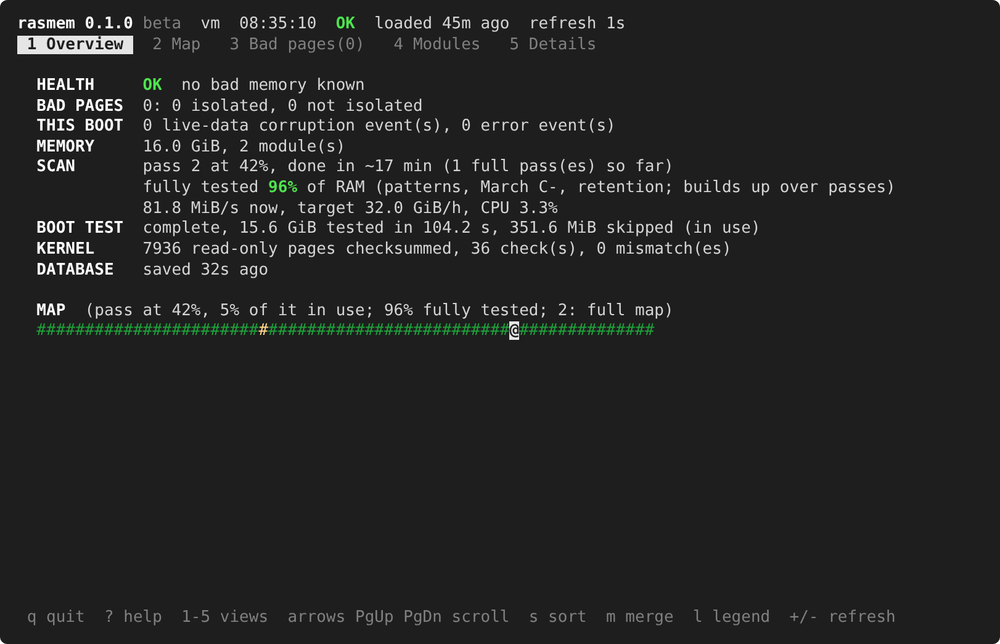
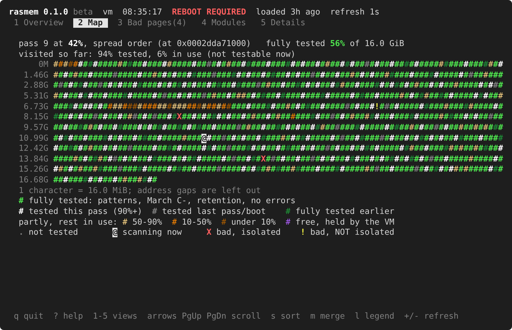

# rasmem — RAS memory test suite for FreeBSD

**Version 0.1.0 — beta.** A test suite for evaluation, not yet a finished
product. Run it on test machines first, and see [Status](#status) below.

rasmem tests the RAM of FreeBSD machines while they run. It is a loadable
kernel module (`rasmem.ko`) and a full-screen viewer (`rasmemstat`). It
tests memory at boot and continuously afterwards, isolates bad pages,
remembers them across reboots, identifies the failing module, and tells you
how serious it is: a bad cell found in free memory, live data hit by bad
memory, or memory that is failing and should be replaced.

It is most valuable on machines **without ECC**, where nothing else notices
bad memory. On machines **with ECC** it covers what ECC does not, and
exercises memory so the hardware finds latent errors early. See
[With and without ECC](#with-and-without-ecc).



## What it does

- **Boot test:** before `init(8)` starts, every core tests all free memory.
  A global address-line test is followed by checkerboard, address and March C-
  patterns per 2 MiB chunk. A key on the console aborts it.
- **Continuous test of free memory:** about 9 MiB tested every second
  (32 GiB/h, or all RAM within 24 h on large machines). The scan is spread
  over all of RAM, passes quickly over memory in use and spends its time on
  the free memory, and rotates March C- and a 1s retention hold so that
  every block eventually gets every test. This tool tests - non aggressively - 
  only the free available memory.
- **Isolation:** bad pages are kept out of use immediately, and at the next
  boot through FreeBSD's own `ram_blacklist`, before anything can allocate
  them.
- **Diagnosis:** each bad page is classified (random flip, weak cell, broken
  cell) by periodic retests. rasmem tracks which data bit and which module
  fails, and warns when memory should be replaced.
- **Kernel image check:** checksums of the read-only kernel code and data,
  verified periodically.
- **Monitoring:** `rasmemstat` (interactive views, a live map of RAM, JSON
  output), sysctl counters, and devd events for alerting.



## With and without ECC

| | Without ECC | With ECC |
|---|---|---|
| Single-bit errors | found by rasmem's tests, pages isolated | corrected by the hardware and logged by `mca(4)`; rasmem's regular reads surface them early, like a patrol scrub |
| Address and decoder faults (data stored in the wrong place) | found by the boot address test and the address patterns | **found**: ECC protects a word's contents, not where it is stored |
| Errors beyond what ECC can correct | found | uncorrectable ones stop the machine (machine check); miscorrected or undetected ones are found by rasmem's comparison |
| Corruption of kernel code from any cause (driver bugs, DMA, CPU) | read-only checksums | read-only checksums |
| ECC modules on a board where ECC is not actually enabled | works as without ECC | (the same) |

rasmem does not read the machine-check log yet: on ECC machines, corrected
errors are not counted in its health and their pages are not isolated
automatically. 

## Quick start

Requirements: **amd64**, FreeBSD **14.x, 15.x or 16-CURRENT**, and the
kernel sources in `/usr/src/sys` (or `SYSDIR=`).

```sh
cd sys/modules/rasmem && make && make install
cd usr.sbin/rasmemstat && make && make install     # installs to /usr/local/sbin
```

Add to `/boot/loader.conf`:

```sh
rasmem_load="YES"
rasmem_db_load="YES"
rasmem_db_type="rasmem_db"
rasmem_db_name="/boot/rasmem.db"
ram_blacklist_load="YES"
ram_blacklist_type="ram_blacklist"
ram_blacklist_name="/boot/rasmem_blacklist.txt"
```

Reboot, then create the two files once with `sysctl hw.rasmem.save=1`, and
run `rasmemstat`. Keys `1`–`5` switch views, and `?` lists all keys.

## Documentation

- [Changelog](CHANGELOG.md)
- Manual page: `rasmemstat(8)`.

## sysctl parameters

All parameters are under `hw.rasmem.`. **Runtime** ones can be changed with
`sysctl` at any time and also set in `/boot/loader.conf`. **Boot** ones are
read only when the module loads: set them in `/boot/loader.conf`. 

Pattern masks combine these bits: `0x01` zeros, `0x02` ones, `0x04`
checkerboard, `0x08` address, `0x10` walking one, `0x20` walking zero,
`0x40` random, `0x80` March C-.

**Continuous scan**

| Parameter | Default | Set | Meaning |
|---|---|---|---|
| `enable` | 1 | runtime | continuous scan on (1) or off (0) |
| `interval` | 1000 | runtime | milliseconds between runs (at least 10) |
| `scan_mb_per_hour` | 32768 | runtime | minimum MiB tested per hour |
| `sweep_hours` | 24 | runtime | test at least all RAM / this many hours per hour (0 off) |
| `pages` | 0 | runtime | fixed pages per run (0: from the rate) |
| `window_mb` | 128 | boot | most memory held for one test window (MiB) |
| `start_delay` | 60 | runtime | seconds after load before the scan starts |
| `scan_order` | 1 | runtime | 0 by address, 1 spread over all RAM |
| `retry_pct` | 10 | runtime | extra % of each run for blocks that were in use (0 off) |
| `break_reserv` | 1 | runtime | test free pages in partly used superpage reservations: 0 never, 1 after a pass, 2 always |
| `periodic_patterns` | 0xcc | runtime | patterns of the scan |
| `march_every` | 10 | runtime | March C- on 1/N of RAM per pass |
| `hold_every` | 10 | runtime | retention hold on 1/N of RAM per pass |
| `hold_ms` | 1000 | runtime | retention hold time (ms) |
| `hold_patterns` | 0x04 | runtime | patterns that get the hold |
| `neighbor_pages` | 64 | runtime | pages on each side of a new bad page to retest (0 off) |
| `page_hints` | 1 | boot | use page-structure hints (reads 0 if switched off at load) |
| `cache_flush` | 0 | runtime | CLFLUSH after pattern writes |

**Boot test**

| Parameter | Default | Set | Meaning |
|---|---|---|---|
| `boot_test` | 1 | boot | 0 off, 1 blocking (before `init`), 2 background |
| `boot_patterns` | 0x8c | boot | patterns of the boot test |
| `boot_threads` | 0 | boot | test threads (0: one per CPU) |
| `boot_global` | 1 | boot | global address-line test (write all, then verify all) |
| `boot_global_reserve_mb` | 512 | boot | memory left free during the global test (MiB) |
| `boot_abort_key` | 1 | boot | a key on the console aborts the boot test |
| `early_mb` | 64 | boot | MiB tested right after the VM system starts |

**Bad pages**

| Parameter | Default | Set | Meaning |
|---|---|---|---|
| `retest_interval` | 600 | runtime | seconds between retests of bad pages (0 off) |
| `retest_patterns` | 0xff | runtime | patterns of the retests |
| `classify_retests` | 8 | runtime | clean retests before a page is called transient |
| `release_transient` | 0 | runtime | give transient pages back to the system |
| `evacuate` | 1 | runtime | move live data off pages known to be bad |
| `hwchange_action` | 1 | runtime | after a memory change: 0 trust the database, 1 re-verify |
| `max_records` | 4096 | boot | most bad-page records |

**Health and warnings**

| Parameter | Default | Set | Meaning |
|---|---|---|---|
| `warn_threshold` | 1 | runtime | corruption events this boot before "reboot" warnings (0 off) |
| `warn_interval` | 60 | runtime | seconds between "reboot required" warnings |
| `panic_threshold` | 0 | runtime | panic after this many corruption events this boot (0 never) |
| `panic_save_timeout` | 120 | runtime | seconds a pending panic waits for the database save |
| `replace_pages` | 16 | runtime | "replace memory" at this many verified bad pages (0 off) |
| `trend_days` | 7 | runtime | window for the trend rule (days) |
| `trend_pages` | 4 | runtime | "replace memory" at this many new bad pages within `trend_days` (0 off) |
| `lane_pages` | 4 | runtime | "replace memory" at this many bad pages failing in the same data bit (0 off) |
| `dimm_pages` | 4 | runtime | "replace memory" at this many bad pages on one module (0 off) |
| `replace_warn_interval` | 3600 | runtime | seconds between "replace memory" warnings |

**Kernel checksums, files and logging**

| Parameter | Default | Set | Meaning |
|---|---|---|---|
| `ro_interval` | 300 | runtime | seconds between checks of the read-only kernel image (0 off) |
| `ro_action` | 1 | runtime | on a mismatch: 0 log, 1 corruption event, 2 panic |
| `db_path` | /boot/rasmem.db | runtime | bad-page database |
| `blacklist_path` | /boot/rasmem_blacklist.txt | runtime | blacklist written for the loader |
| `save_interval` | 300 | runtime | seconds between saves of changed statistics |
| `verbose` | 0 | runtime | verbose logging (also with `boot -v`) |
| `allow_inject` | 0 | boot | allow the fake-error controls (testing only) |

**Read-only and actions:** `version` (release), `stat.*` (counters such as
`stat.health`), and `regions`, `stats`, `dimm_info` and `map` (binary, read
by rasmemstat). Writing 1 to `save`, `scan_now`, `ro_rebaseline` or `reset`
saves the database, runs a scan, recomputes the kernel checksums or clears
this boot's error state. `forget` takes a physical address and drops its
record. `inject` and `inject_corrupt` fake errors (with `allow_inject=1`).

## Status

This is a **beta test suite**:

- The code compiles warning-free (`-Werror`, kernel warning flags) against
  FreeBSD 14, 15 and 16-CURRENT headers.
- The test engine was verified with injected faults in userland, and the
  scan and allocation logic against a model of FreeBSD's allocator.
- The author has booted and used it on FreeBSD. Broad testing on different
  physical machines, and with real failing modules, is still to be done.
  Reports are very welcome.
- The screenshots show rasmemstat running against **simulated data**
  (a 16 GiB machine), not a real failing module.

rasmem never moves data in order to test memory, and panicking on errors is
**off** by default.

## Source layout

```
sys/dev/rasmem/rasmem.h        shared ABI: version, sysctl structures, database
                               format, coverage map format
sys/dev/rasmem/rasmem_var.h    kernel-internal declarations
sys/dev/rasmem/rasmem_test.c   pattern engine, March C-, taking exact physical
                               ranges, evacuation, scan windows, segment map
sys/dev/rasmem/rasmem_smbios.c module inventory, address-to-module map,
                               hardware fingerprint
sys/dev/rasmem/rasmem.c        phases, records, classification, health policy,
                               persistence, coverage map, sysctls
sys/modules/rasmem/Makefile    kernel module build
usr.sbin/rasmemstat/           viewer: interactive views, map, JSON, database
                               dump; rasmemstat.8
docs/screenshots/              screenshots
```

## Architecture

**Phase 1** runs from a `SYSINIT` at `SI_SUB_KLD`, right after the VM system
is up. It loads the database preloaded by the loader (`rasmem_db`) and takes
the still-free known bad pages out of circulation. It checksums the kernel's
read-only image (`btext` up to the read/write section) and tests a few MiB of
free pages.

**Phase 2** runs at `SI_SUB_KTHREAD_INIT`, before `init(8)` is started. It
starts the `rasmem` kernel process and, for the boot test, one worker thread
per CPU bound to that CPU. Kernels without `EARLY_AP_STARTUP` defer the boot
test until the APs run.

**Phase 3** is the `rasmem` process's main loop, scheduled with `sbintime`:

- periodic runs;
- neighbourhood retests;
- bad-page retests;
- read-only checks;
- health evaluation, warnings and saving.

All shared state is protected by one mutex. Saving is serialized by an sx
lock and done by the main thread: it writes `rasmem.db.new` with synchronous
writes, then renames it over the old file, so a crash leaves either the old
or the new database, never a half-written one.

### Taking memory

rasmem writes only to memory it owns. It takes free pages with
`vm_page_alloc_noobj_contig_domain()` for exactly the physical range it wants
(`low = pa`, `high = pa + size`), and checks the returned address.

**Free memory first.** The rate is memory tested per hour. Pieces the hints
show in use cost 1/`RASMEM_SKIP_DIV` (16) of a tested page against the
run's quota, and a run walks at most 16 times its quota. A busy machine
therefore reaches its rate on the free memory, with shorter passes, instead
of spending most of each run walking memory in use. Without the hints every
piece costs an allocator call and counts in full.

### Kernel interfaces used

Most of what rasmem uses is ordinary kernel API. Where it touches VM
internals, the code is arranged so that a change in a future FreeBSD version
costs speed or coverage, not correctness, and is detected at load:

| Use | Interface | Kind | If it changes |
|---|---|---|---|
| take an exact free range | `vm_page_alloc_noobj_contig_domain()` | KPI | authoritative; compile error at worst |
| find the free block containing a page | hints (one call); without hints, probing aligned heads | **internal** / KPI | a wrong guess costs a failed call |
| evacuate a known bad page | `vm_page_reclaim_contig_domain()` | KPI | |
| break a partly used reservation | `vm_page_alloc_noobj_contig_domain()` without `VM_ALLOC_NORECLAIM` (calls `vm_reserv_reclaim_contig()`) | KPI | |
| "is it free?" hints | `m->object`, `m->ref_count` | **internal** | checked against the allocator at load, switched off on disagreement (`hw.rasmem.page_hints`) |
| evacuation pre-check | `m->object`, `m->ref_count`, `m->oflags` | **internal** | without hints: the kernel's evacuation decides |
| finish lazy page initialization (FreeBSD 15+) | `vm_phys_find_range()` side effect | **internal** | only needed for the hints; the hint check catches it |
| physical segments | `vm_phys_segs[]` | internal, long stable | validated at load (order, domains, page structures); rasmem disables itself if not as expected |
| buddy block size | `VM_NFREEORDER` | machine header | fallback value; affects efficiency only |
| boot blacklist | `vm.page_blacklist` (text) | sysctl | format checked; ignored with a message if unexpected |
| read-only image | `btext`, `brwsection` from `<machine/cpu.h>` | MD, stable | |
| module inventory | SMBIOS via `pmap_mapbios()` | KPI | |
| direct map | `PHYS_TO_DMAP()` / `PHYS_TO_DMAP_ADDR()` | KPI (MD) | both spellings handled |

The lockless reads are hints only. The allocator call that follows is
authoritative, so a stale or meaningless hint costs a failed allocation or
a missed range, never a write to memory rasmem does not own.

At load, rasmem takes 64 pieces of 256 KiB (64 pages each) spread over
memory with the allocator and compares them with what the hint says. Free
pieces that the hint calls "in use" mean the hint no longer works, and it is
switched off if that happens for more than 1 in 10 free pieces. The reverse
(hint "free", allocator "not free") is normal: per-CPU page caches and
superpage reservations hold pages that look free. With hints off
everything still works. Ranges that are in use cost allocator calls, and
the scan can no longer pass over them cheaply.

The remaining wish is a small KPI in FreeBSD itself, "allocate exactly this
physical range", which would replace the probing and the hints entirely.

### ABI

`rasmem.h` defines everything shared with userland. All structures are
fixed-size, and static assertions check their sizes.

| What | Version |
|---|---|
| release | `RASMEM_VERSION` "0.1.0" (`hw.rasmem.version`) |
| sysctl structures (`regions`, `stats`, `dimm_info`) | `RASMEM_ABI_VERSION` 3 |
| database file | `RASMEM_DB_VERSION` 2; version 1 files are read and upgraded |
| coverage map (`hw.rasmem.map`) | `RASMEM_MAP_VERSION` 4 |

rasmemstat refuses to run against a different ABI version, and says so.

### Coverage map

The map has one 16-bit cell per 2 MiB of RAM (coarser above 2 TiB), indexed
by linear page number, with holes removed. The bits record what the current
pass did in the cell:

- visited;
- tested or skipped (in use), and whether free memory was held by the VM;
- March C- or retention hold applied;
- a test failed;
- retried.

Three more bits record what the previous pass found (tested, skipped, held). Three accumulated "done"
bits record the plain patterns, March C- and retention, each credited only
when one pass covered the whole cell without a skipped page or an error.

The kernel also counts, per cell, how many pages the current pass actually
tested. The map exports that as a 0–255 "tested share" for the current
pass and for the previous one. The flags say what happened in a cell, the
share says how much of it; the rest was in use. Retries keep the better of
the two counts for a cell.

When a pass completes, it is folded into the "previous" and "done" bits and
the previous share. A new error clears the cell's "done" bits. The boot test
writes the "previous" and "done" bits and the previous share directly.

## Authors

Viktor Hlavaji <davies@npulse.net>, developed with the assistance of Claude (Anthropic), an AI assistant.

## License

BSD 2-Clause, see [LICENSE](LICENSE).
Copyright (c) 2026 Viktor Hlavaji (DaVieS).
